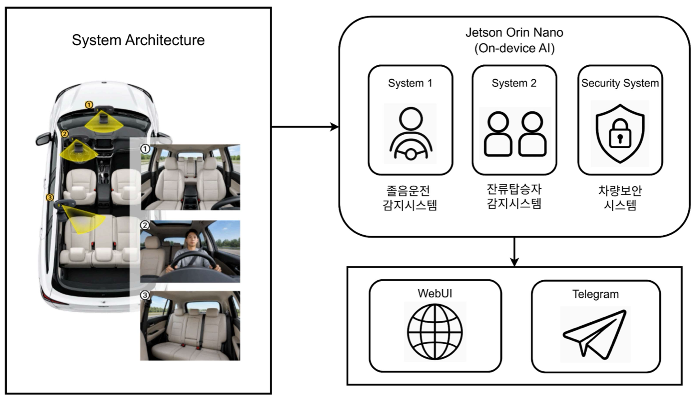
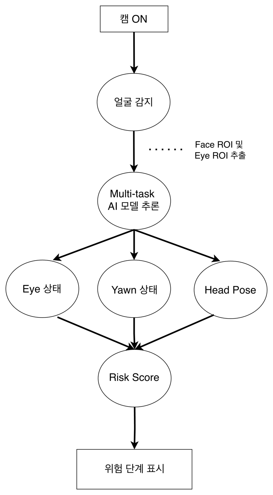
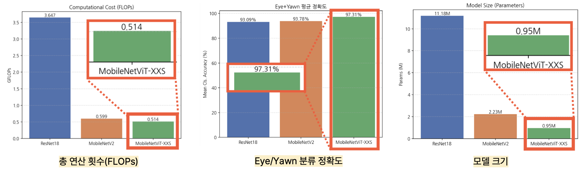
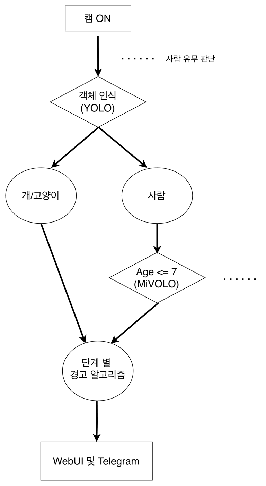
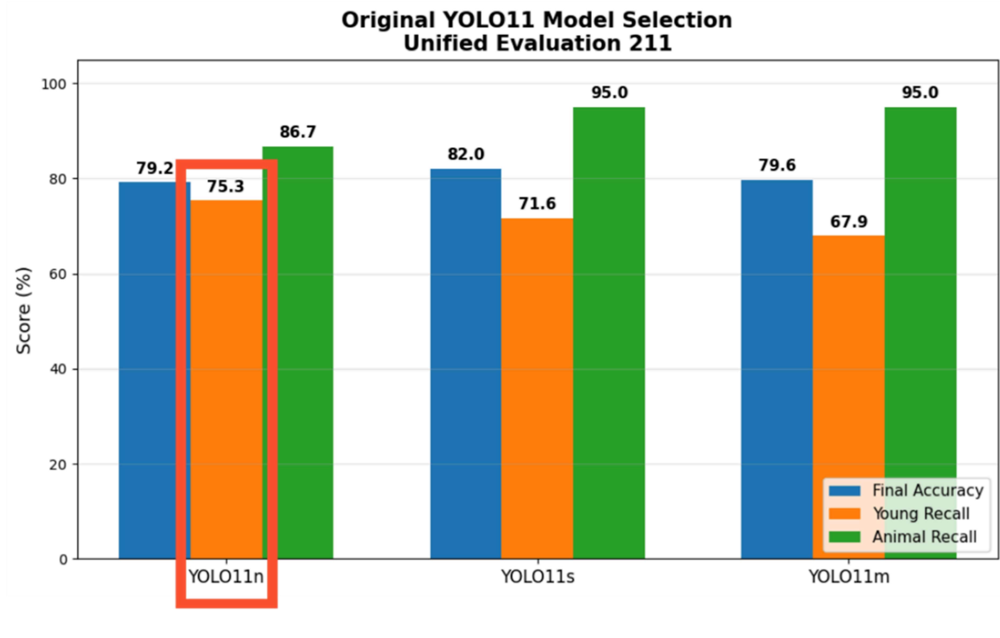
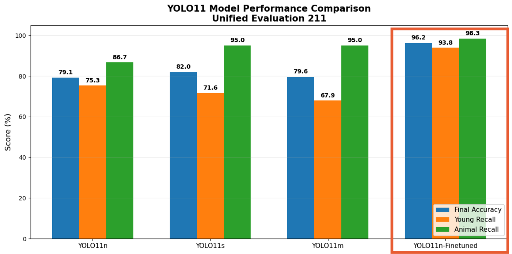
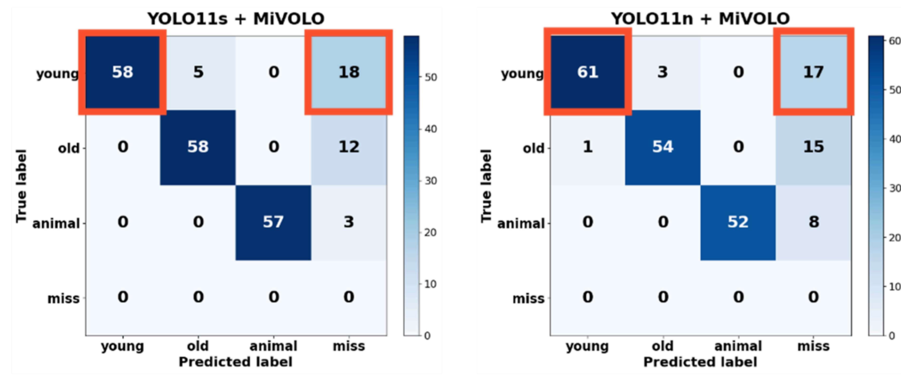
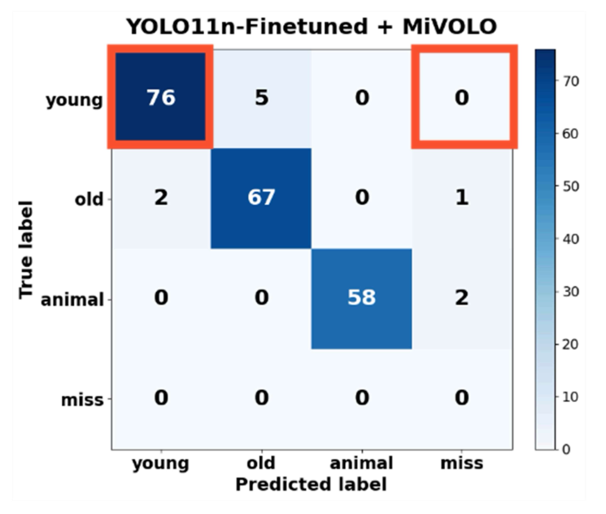
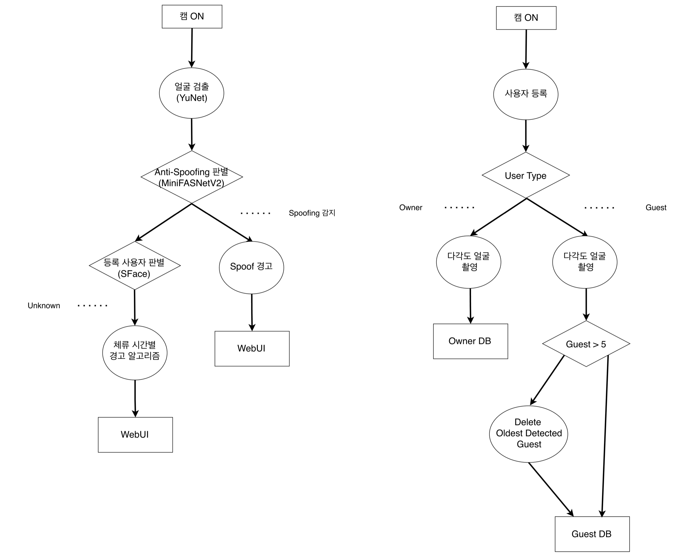

# On-Device AI Vehicle Safety Monitoring System

Jetson Orin Nano에서 동작하는 **On-Device AI 기반 차량 통합 안전 모니터링 시스템**입니다.

운전자 졸음 상태, 차량 내부 잔류 탑승자, 차량 접근 보안을 각각 분석하고 Web UI 및 알림 시스템과 연동합니다.

| 항목 | 내용 |
|---|---|
| 기간 | 2026.08.05 ~ 2026.08.19 |
| 형태 | 3인 팀 |
| 담당 | 1열 졸음 감지 모델(ResNet18 · MobileNetV2 · MobileViT-XXS) 학습 · 시연 영상 제작 / 2열 MiVOLO GPU 실행 환경 · E2E Latency · FPS 분석 / 차량 보안카메라(YuNet · MiniFASNetV2 · SFace) · Web UI 구현 · 시연 영상 제작 · 시연 |
| 플랫폼 | NVIDIA Jetson Orin Nano · JetPack 6.2.2 · CUDA 12.6 · TensorRT |

## 핵심 결과

- 졸음 감지 **MobileViT-XXS 97.31%**: ResNet18 대비 +4.22%p · 연산량 약 1/7.1, MobileNetV2 대비 +3.53%p · 연산량 약 1/1.2
- 잔류 탑승자 감지 **YOLO11n Fine-tuning**: Young Recall **75.3% → 93.8%**, Young Miss **17건 → 0건**, Animal Recall 98.3%
- Jetson 실측(E2E Latency · FPS · 전력)으로 YOLO11 n / s / m을 비교해, 7세 이하 아동 미검출을 최소화하는 **Young Recall 기준**으로 모델 선정

## System Overview

전체 시스템은 세 개의 AI Subsystem으로 구성됩니다.

1. **Driver Monitoring** — 운전자 졸음 위험 판단
2. **Rear-seat Occupant Monitoring** — 아동 및 반려동물 잔류 감지
3. **Vehicle Security Camera** — 등록 사용자 / 미등록 사용자 / Spoof 판별

<p align="center">
  
</p>

## 1. Driver Monitoring

한 개의 Multi-task Model에서 다음 정보를 동시에 추론합니다.

- Eye: Open / Closed
- Yawn: Yawn / No Yawn
- Head Pose: Normal / Down

<p align="center">
  
</p>

### Risk Score

```text
Risk Score
= 0.45 × Eye Closed Ratio
+ 0.25 × Yawn Score
+ 0.30 × Head Down Ratio
```

| State | Condition |
|---|---|
| NORMAL | Score < 0.40 |
| WARNING | 0.40 ≤ Score < 0.70 |
| DANGER | Score ≥ 0.70 |

시작 시 약 2초간 정면 자세를 기준으로 Head Pose Baseline을 자동 보정합니다.

### Compared Models

- ResNet18
- MobileNetV2
- MobileViT-XXS

<p align="center">
  
</p>

MobileViT-XXS가 연산량(0.514 GFLOPs)과 모델 크기(0.95 M)가 가장 작으면서 Eye/Yawn 분류 정확도는 가장 높은 **97.31%**여서 최종 모델로 선정했습니다.

## 2. Rear-seat Occupant Monitoring

YOLO11로 사람 · 개 · 고양이를 검출하고, 사람은 MiVOLO V2로 나이를 추정해 7세 이하 아동과 동물을 잔류 위험 대상으로 구분합니다. 시동 종료 여부와 경과 시간에 따라 경고 Stage 1~3을 전환합니다.

<p align="center">
  
</p>

### Final Detection Model

**Fine-tuned YOLO11n**

| Model | Accuracy | Young Recall | Animal Recall |
|---|---:|---:|---:|
| YOLO11n | 0.791469 | 0.753086 | 0.866667 |
| YOLO11s | 0.819905 | 0.716049 | 0.950000 |
| YOLO11m | 0.796209 | 0.679012 | 0.950000 |
| **YOLO11n Fine-tuned** | **0.962085** | **0.938272** | **0.983333** |

<p align="center">
  
</p>

Final Accuracy는 YOLO11s가 가장 높았지만, 7세 이하 아동을 놓치지 않는 것이 우선이므로 **Young Recall**이 가장 높은 YOLO11n을 Base Model로 선정했습니다.

아동과 동물의 인식 성능을 동시에 개선한 Fine-tuned YOLO11n을 최종 모델로 선정했습니다.

<p align="center">
  
</p>

**Jetson Orin Nano 실측 (Fine-tuning 전 기준)**

| 항목 | YOLO11n | YOLO11s | YOLO11m |
|---|---:|---:|---:|
| E2E Latency | 886.82 ms | 895.36 ms | 958.56 ms |
| FPS | 1.139 | 1.133 | 1.076 |
| Average Power | 6,808 mW | 6,807 mW | 6,863 mW |
| Energy / Frame | 0.865 J | 0.865 J | 0.872 J |
| Parameters | 2.6 M | 9.4 M | 20.1 M |
| FLOPs | 6.5 B | 21.5 B | 68.0 B |

**Fine-tuning으로 Young 미검출 개선**: YOLO11n / s Confusion Matrix를 비교한 결과, Young Miss 샘플은 얼굴·상반신 중심 구도에서 Person 검출이 누락된 경우에 집중되어 있었습니다.
이 구도를 보강해 Fine-tuning한 결과 Young Miss가 17건에서 0건으로 줄었고, Young Recall +18.5%p · Animal Recall +11.6%p가 향상되었습니다.

| Before (YOLO11s / YOLO11n + MiVOLO) | After (YOLO11n Fine-tuned + MiVOLO) |
|---|---|
|  |  |

## 3. Vehicle Security Camera

차량 접근 인물을 얼굴 검출(YuNet) → Anti-Spoofing(MiniFASNetV2) → 얼굴 인식(SFace) 순서로 분석해 OWNER / GUEST / UNKNOWN / SPOOF로 판별합니다. 오른쪽은 사용자 등록 흐름(Guest는 최대 5명, 초과 시 가장 오래된 Guest 삭제)입니다.

<p align="center">
  
</p>

### Security Policy

- `OWNER` / `GUEST`: 등록 사용자
- `UNKNOWN`: 미등록 사용자
- `SPOOF`: 사진 / 화면 등을 이용한 위조 입력

`UNKNOWN` 상태가 지속될 경우:

- **10초** → Capture
- **30초** → Alarm

## Trouble Shooting (담당 파트)

1. **MiVOLO가 GPU에서 구동되지 않아 FPS 저하**
   MiVOLO 모델의 ONNX 포맷이 GPU 실행을 지원하지 않아 CPU에서 동작했고, 영상 출력 Latency가 커졌습니다.
   → TorchScript(`.pt`)로 전환해 GPU에서 구동
2. **코드 변경 없이 MiVOLO Inference Time이 달라지는 현상**
   YOLO11 n / s / m 비교 중, 프레임마다 검출되는 사람 수가 달라 MiVOLO 호출 횟수가 달랐습니다.
   → 호출 횟수로 나눈 1회당 Inference Time으로 비교해 모델 간 차이가 없음을 확인
3. **졸음 감지 Classification 모델의 시연 환경 의존성**
   차량 내부 환경까지 함께 학습되어 실제 시연 환경에서 인식이 어려웠습니다.
   → 눈 감김 · 하품 · 고개 각도를 각각 판단하는 Multi-task 모델로 변경

## AI Models

| Task | Model |
|---|---|
| Driver Multi-task Classification | ResNet18 / MobileNetV2 / MobileViT-XXS |
| Person / Animal Detection | YOLO11 |
| Age Estimation | MiVOLO V2 |
| Face Detection | YuNet |
| Anti-Spoofing | MiniFASNetV2 |
| Face Recognition | SFace |

## Optimization

Jetson Orin Nano의 실시간 추론 성능을 고려해 다음 실행 방식을 활용합니다.

- PyTorch CUDA
- TensorRT FP16
- TorchScript
- ONNX

## Hardware / Software

- NVIDIA Jetson Orin Nano
- JetPack 6.2.2
- CUDA 12.6
- Python
- PyTorch
- TensorRT
- OpenCV
- ONNX

## Repository Structure

```text
Car_Safety_Based_Jetson/
├── system1/            # Driver Monitoring
│   ├── multitask_exe.py              # 실행
│   ├── inference_time_on_jetson.py   # Jetson 추론 시간 측정
│   └── *.pth / *.onnx                # ResNet18 · MobileNetV2 · MobileViT-XXS
├── system2/            # Rear-seat Occupant Monitoring
│   ├── yolo_mivolov2_exe.py          # YOLO11 + MiVOLO V2 실행
│   ├── alert_server.py / alert_client.py / dashboard.html
│   ├── inference_time.py
│   └── yolo11{n,s,m} · YOLO11n_Finetuned · mivolo_v2 (.pt / .onnx / .engine)
├── security_system/    # Vehicle Security Camera
│   ├── security_exe.py · security_policy.py · web_alarm.py
│   ├── face_detector.py · anti_spoof.py · face_recognizer.py
│   └── register_person.py · manage_people.py
├── docs/               # README 이미지
└── README.md
```

실행 방법은 각 폴더의 `실행방법_*.md`를 참고하세요.

## Key Contributions

- 서로 다른 차량 안전 문제를 하나의 Edge AI Platform으로 통합
- Cloud 의존도를 낮춘 On-Device Inference
- Accuracy뿐 아니라 실제 실시간 실행 가능성을 고려한 Model Selection
- 상태 지속시간을 반영한 단계별 Risk / Security Policy
- Web UI 및 외부 알림 시스템 연동
